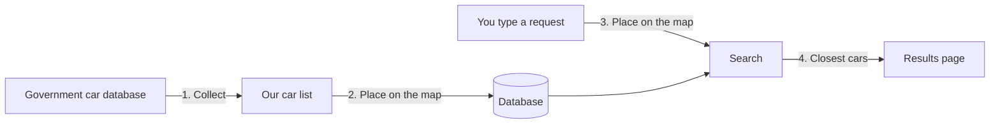

# How VectorRAGNuxt works

**In one sentence:** you type what you're looking for in your own words, and the app finds the cars whose names are closest in *meaning*, not just in spelling.

The plan for building the search part is in [the spec](specs/ingest-search.md).

## The idea, without the jargon

Ordinary search matches words. Type "civic" and it finds text containing "civic". It can't tell that "small Honda" and "Civic" are related.

This app uses an AI model to place every car on a **map of meaning**. Cars that are similar end up near each other, the way a library shelves books about the same topic together. When you type a request, the same model places it on the map, and we show you the cars closest to it.

*It's a lot like a library, except nobody shushes you and half the books are Hondas.*

That technique is called **vector search**. It's the first half of **RAG** (retrieval-augmented generation), the pattern most "chat with your data" products use:

1. **Retrieve:** find the most relevant items (this app, today).
2. **Generate:** hand those items to a chat AI and let it write a helpful answer (a later step).

## How it works, step by step

**Done once, ahead of time:**
1. **Collect:** download every passenger car model sold in the US from 2016 to 2026 from a free government database.
2. **Describe:** a writing AI adds a sentence or two per car ("Compact sedan known for reliability…"), so the map knows more than the name.
3. **Place on the map:** send each car's name and description to an AI model, which turns it into a map position, and save the positions in our database.

**Every time someone searches:**

4. **Place the request on the map:** the same AI model turns the request into a position. If the request has a year in it ("2018 accord"), the year is set aside as a filter.
5. **Find the neighbors:** the database returns the cars closest to that position, best match first, skipping any not sold in the requested years (two years either side of a single year).

## What's in the data

| | |
|---|---|
| **Source** | The US government's free vehicle database ([NHTSA vPIC](https://vpic.nhtsa.dot.gov/api/)) |
| **Covers** | Passenger cars, model years 2016–2026 |
| **Size** | 673 car models from 149 manufacturers (4,414 model-year combinations) |
| **Each car has** | Manufacturer, model name, the years it was sold, and a short **AI-written** description |

**What's missing, and why it matters:**
- **No SUVs, vans or pickups.** The government database files them separately. Searching for "family SUV" won't find a Honda CR-V, because it isn't in the data. *Vans in particular have pulled quite the van-ishing act.*
- **No verified facts, prices or specs.** The descriptions come from an AI's general knowledge, not a spec sheet, so they can be wrong. The page says so. Cars the AI doesn't recognize are described as "Lesser-known model from MAKE" rather than guessed at. *We asked it not to make things up, and unlike a used-car salesman, it mostly listens.*
- **No curation.** Limo builders and kit-car makers are included alongside Toyota and BMW, and they can show up in results.

## What to expect from results

| Request | Expected quality | Why |
|---|---|---|
| "honda civic", "civic type r" | **Good** | Close to the names we have |
| "2018 accord" | **Good** | Matches by name, filtered to models sold 2016–2020 |
| "small honda", "cheap reliable car" | **Fair to good** | The descriptions now carry words like "compact" and "affordable" for well-known models |
| "something like a Kandi K27" | **Poor** | Obscure models only get "Lesser-known model", so there's little to match |
| "family SUV", "pickup truck" | **None** | Those vehicles aren't in the data |

These are expectations, not measurements yet; the table gets real scores once we've run each request. How we'll measure them, and decide whether a change is a win, is in [Measuring search quality](evaluation.md).

## Cost

- **Writing descriptions:** a few cents for the whole catalog, once. Only new cars are described on later runs.
- **Setting up the map:** a fraction of a cent for the whole catalog, plus again whenever the car list or descriptions change. *Cheaper than a car wash, and you don't even have to vacuum the seats.*
- **Each search:** one tiny AI call, a fraction of a cent.
- **Risk:** each search costs a little money, so the app must not be public until it has login or rate limits. For now it runs locally only.

## Glossary

- **Embedding / vector:** a car's (or request's) position on the map of meaning, stored as a long list of numbers.
- **Vector search:** finding the stored positions closest to a new one.
- **RAG:** retrieval-augmented generation. Find relevant data first, then let an AI write an answer using it.
- **Score:** how close a result is, from 0 to 1. **0.5 means "unrelated"**, not "half a match". *It's the search engine's way of saying "it's not you, it's me."*

---

## Appendix: the technical detail

The sections below are for engineers and the curious. Click to expand.

Architecture and data notes

- Pipeline: `pnpm scrape` (vPIC → `data/cars.json`) → `pnpm describe` (`gpt-5-mini` → `data/descriptions.json`) → `pnpm ingest` (group, embed, upsert into Mongo) → `POST /api/search` (pull out years, embed the rest, `$vectorSearch` with a `years` pre-filter).
- Embedding model: OpenAI `text-embedding-3-small`, 1,536 dimensions. The text embedded per model is `"{make} {model}. {description}"`, e.g. `"HONDA Civic. Compact sedan/hatchback known for reliability…"` (about 40 tokens), or just the name if there's no description.
- **One doc per make+model, not per year.** `"HONDA Civic"` is identical text in 2016 and 2024, so per-year docs would produce 11 identical vectors and flood the results. Grouping turns 4,414 rows into 673 docs, each with a `years` array.
- vPIC files SUVs and vans as "multipurpose passenger vehicle" and pickups as "truck"; we scrape type "car" only.
- Largest makes by row count: BMW 302, Audi 201, ARMBRUSTER STAGEWAY 176 (a limo builder).

Code map

| File | What it does |
|---|---|
| `scripts/scrape-cars.ts` | `pnpm scrape` CLI: fetches from vPIC into a resumable cache (`data/.cache/`), then rebuilds `data/cars.json` from the whole cache |
| `scripts/lib/scrape.ts` | Pure scraper helpers: vPIC types, safe cache names (S8), rows from cached model lists |
| `scripts/describe-cars.ts` | `pnpm describe` CLI: batches of 40, resumable, saves after every batch, stops on the daily limit |
| `scripts/lib/describe.ts` | Description prompt, schema and checks (`cleanDescription`, P1–P6); `describeCars()` keeps only valid answers for cars it asked about |
| `scripts/screenshot.ts` | `pnpm screenshot`: headless-Chromium screenshots of the search page, with `/api/search` mocked unless `--real` |
| `scripts/eval.ts` | `pnpm eval run` / `compare`: scores search against `eval/golden.json` and makes the win/loss call |
| `scripts/lib/eval.ts` | Metrics (nDCG@5, Hit@1, MRR, Recall@5), paired bootstrap, and the win/loss rules from [evaluation.md](evaluation.md) |
| `eval/golden.json` | The labeled searches; `reviewed: false` until a person has checked each |
| `scripts/lib/util.ts` | Shared CLI helpers: atomic writes, the worker pool |
| `scripts/ingest-cars.ts` | `pnpm ingest` CLI: reads env and descriptions, connects, calls the ingest library |
| `scripts/lib/ingest.ts` | Groups rows into models (with descriptions); embeds only new, changed, or other-model ones (`needsEmbedding`); upserts; removes stale models; creates or upgrades the vector index and waits until it's ready |
| `shared/utils/embedding.ts` | **The one place** that defines the embedding model, dimensions, text format, collection and index names, and `embedTexts()`. Ingest and search both use it |
| `shared/types/car.ts` | `Car` (scraped row), `CarModel` (client), `CarDoc` (Mongo, server only), `SearchResult` (API) |
| `server/utils/search.ts` | Framework-free search logic: JSON check (S1), body validation (S2), `parseYearFilter()`, `searchCars()` |
| `server/utils/catalog.ts` | `getCatalogSummary()`: model count and year span, for `GET /api/catalog` |
| `shared/utils/years.ts` | `formatYears()`: the one year-range formatter, used by the page and the describe prompt |
| `server/utils/db.ts` | `getDb()`: one shared Mongo connection; a failed connect is retried on the next call |
| `server/utils/openai.ts` | `getOpenAI()`: one shared OpenAI client, created on first use |
| `server/api/search.post.ts` | `POST /api/search`: maps the search logic onto HTTP (415 / 400 / 502 with generic messages, S6) |
| `app/pages/index.vue` | Search box and result cards (Nuxt UI) |
| `docker-compose.yml` | Local Mongo + mongot: loopback only (S5), mongot index in RAM (disk-threshold workaround) |
| `tests/unit/` | Validation, year parsing, description checks, grouping, re-embed rules, cache-name safety |
| `tests/integration/` | Real Mongo + mongot with a stand-in OpenAI: ingest, index (and upgrade), ranking, year filter, descriptions, no leaked fields, stale removal |
| `tests/fixtures/fake-openai.ts` | Stand-in `/v1/embeddings` (trigram vectors) and `/v1/responses` (scripted descriptions, including misbehaving ones) |

**Testing without an OpenAI key:** the SDK accepts a `baseURL` (or the `OPENAI_BASE_URL` environment variable), so the tests point it at `tests/fixtures/fake-openai.ts`. That exercises everything except real match quality.

The vector math

### 1. An embedding is a point in space

An embedding model is a function from text to a list of numbers:

$$
E(\text{"HONDA Civic"}) = \mathbf{v} = (v_1, v_2, \dots, v_{1536}) \in \mathbb{R}^{1536}
$$

No single dimension means "is a sedan"; meaning is spread across all 1,536 numbers. What we can rely on is the geometry: **closeness in space ≈ closeness in meaning.**

### 2. Dot product, length and angle

For $\mathbf{a}, \mathbf{b} \in \mathbb{R}^n$:

$$
\mathbf{a} \cdot \mathbf{b} = \sum_{i=1}^{n} a_i b_i
\qquad
\|\mathbf{a}\| = \sqrt{\mathbf{a} \cdot \mathbf{a}}
\qquad
\mathbf{a} \cdot \mathbf{b} = \|\mathbf{a}\|\,\|\mathbf{b}\| \cos\theta
$$

Rearranged, that's **cosine similarity**, the measure our index uses:

$$
\cos\theta = \frac{\mathbf{a} \cdot \mathbf{b}}{\|\mathbf{a}\|\,\|\mathbf{b}\|}
$$

A value of 1 means the same direction (same meaning) and 0 means perpendicular (unrelated). Cosine compares direction and ignores length.

*I'd tell you a joke about perpendicular vectors, but they have nothing in common.*

### 3. Why cosine, dot product and distance all agree here

OpenAI's embeddings are normalized ($\|\mathbf{a}\| = 1$), so $\cos\theta = \mathbf{a}\cdot\mathbf{b}$ and

$$
\|\mathbf{a} - \mathbf{b}\|^2 = \mathbf{a}\cdot\mathbf{a} - 2\,\mathbf{a}\cdot\mathbf{b} + \mathbf{b}\cdot\mathbf{b} = 2 - 2\cos\theta
$$

Higher cosine ⇔ higher dot product ⇔ smaller distance: all three rank results identically. We use `cosine` because it stays correct even with a model that doesn't normalize.

### 4. Worked example (3 dimensions instead of 1,536)

| Text | Vector |
|---|---|
| prompt: "small honda" | $\mathbf{q} = (0.8,\ 0.6,\ 0)$ |
| "HONDA Civic" | $\mathbf{a} = (0.6,\ 0.8,\ 0)$ |
| "BMW M8" | $\mathbf{b} = (0,\ 0.6,\ 0.8)$ |

$$
\mathbf{q}\cdot\mathbf{a} = 0.48 + 0.48 = 0.96 \ (\theta \approx 16^\circ)
\qquad
\mathbf{q}\cdot\mathbf{b} = 0.36 \ (\theta \approx 69^\circ)
$$

The Civic wins. Distance agrees: $\|\mathbf{q}-\mathbf{a}\|^2 = 0.2^2 + 0.2^2 = 0.08 = 2 - 2(0.96)$.

### 5. What Mongo's score means

`$vectorSearch` rescales cosine from $[-1, 1]$ to $[0, 1]$:

$$
\text{score} = \frac{1 + \cos\theta}{2}
$$

The Civic scores 0.98 and the BMW 0.68. A score of 0.5 means unrelated. Real scores bunch up, so rank matters more than the absolute number, and you shouldn't hard-code a threshold without looking at real scores first.

### 6. Exact vs approximate search

Brute force means computing the dot product with every stored vector: $673 \times 1536 \approx 1$ million multiplications, about a millisecond. At millions of vectors that's too slow, so Mongo's index uses **HNSW**, a layered graph that a search walks greedily toward the query. It only visits a fraction of the vectors, at the cost of being *approximate*. `numCandidates` is the dial: explore more candidates for better recall but a slower query. Mongo suggests 10–20× `limit`.

### 7. Why bare names are weak, and what descriptions change

The vector for `"HONDA Civic"` carries whatever the model learned about Civics (compact, affordable, reliable), so concept queries can work for famous models. Obscure names carry little. Adding a description puts those concepts into the text itself: `"HONDA Civic. Compact sedan/hatchback known for reliability, fuel efficiency…"` lands much nearer "cheap reliable car" than the name alone does.

The trade-off is that the name is now a smaller share of the text, so pure name searches ("civic") score a little lower than before, and a confidently wrong description pulls a car toward the wrong neighbors. That's why unknown cars get a deliberately bland "Lesser-known model from MAKE."

### 8. Filtering by year

A year isn't meaning, it's a fact, so it doesn't go into the vector. `"2018 accord"` embeds as `"accord"` and adds a pre-filter: only docs whose `years` array contains any of 2016–2020 are searched at all. Pre-filtering happens inside the HNSW walk, so you still get `limit` results (when that many exist) rather than five results minus whatever a later filter throws away.

### 9. Where the "G" fits later

Generation pastes the top results into a chat prompt and lets the model write the answer. Retrieval decides which facts the model sees, so it has to be right first.

