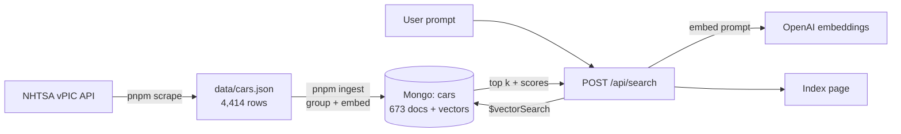

# How VectorRAGNuxt works

This is the system doc: what the pieces are, what data goes in, and the math that makes "find the closest car" work. The plan for building the search part is in [specs/ingest-search.md](specs/ingest-search.md).

## The pipeline

Two phases:

1. **Offline, done once:** scrape the cars, turn each car model into a vector, and store it.
2. **Per request:** turn the user's prompt into a vector *the same way*, then ask Mongo which stored vectors are closest.

That's the "R" in RAG (retrieval-augmented generation). The "G" comes later: hand the retrieved cars to a chat model and have it write the answer. Retrieval is the part that needs the math.

## What we're seeding

| | |
|---|---|
| Source | [NHTSA vPIC](https://vpic.nhtsa.dot.gov/api/), the US government's vehicle database. Free, no key. |
| Scope | Vehicle type **car** (passenger cars), model years **2016–2026** |
| Raw rows | 4,414 (make, model, year) rows from 149 makes |
| After grouping | **673 make+model docs**, each with a `years` array (average 6.6 years per model) |
| Text embedded | `"{make} {model}"`, e.g. `"HONDA Civic"`, about 17 characters / 6 tokens each |

What's **not** in the data:
- **SUVs, vans and pickups.** vPIC files them as "multipurpose passenger vehicle" or "truck", not "car". A Honda CR-V isn't in the data; a Civic is.
- **Descriptions, prices, specs.** vPIC gives names only.
- **Curation.** Limo, replica and kit-car builders are included; ARMBRUSTER STAGEWAY alone has 176 rows. BMW (302), Audi (201) and Mercedes-Benz (114) are the biggest mainstream makes.

Why group by model? `"HONDA Civic"` is the same text in 2016 and 2024. Separate per-year docs would produce 11 identical vectors and flood the top results with Civics.

---

## The vector math

### 1. An embedding is a point in space

An embedding model is a function from text to a list of numbers:

$$
E(\text{"HONDA Civic"}) = \mathbf{v} = (v_1, v_2, \dots, v_{1536}) \in \mathbb{R}^{1536}
$$

The model was trained so that texts with similar meaning land on nearby points. No single dimension means "is a sedan". Meaning is spread across all 1,536 numbers. What we can rely on is the geometry: **closeness in space ≈ closeness in meaning.**

So "find the closest car to this prompt" becomes "find the stored vector nearest to the prompt's vector". To do that, we need a way to measure "near".

### 2. Dot product, length, and angle

For two vectors $\mathbf{a}, \mathbf{b} \in \mathbb{R}^n$:

$$
\mathbf{a} \cdot \mathbf{b} = \sum_{i=1}^{n} a_i b_i
\qquad
\|\mathbf{a}\| = \sqrt{\mathbf{a} \cdot \mathbf{a}}
$$

The dot product relates to the angle $\theta$ between them:

$$
\mathbf{a} \cdot \mathbf{b} = \|\mathbf{a}\|\,\|\mathbf{b}\| \cos\theta
$$

Rearranged, that's **cosine similarity**, the measure our index uses:

$$
\cos\theta = \frac{\mathbf{a} \cdot \mathbf{b}}{\|\mathbf{a}\|\,\|\mathbf{b}\|}
$$

- $\cos\theta = 1$: same direction (same meaning)
- $\cos\theta = 0$: perpendicular (unrelated)
- $\cos\theta = -1$: opposite directions (rare in practice; real embeddings mostly sit in a narrower range)

Cosine ignores length and compares only *direction*. A long text and a short text about the same thing can have vectors of different lengths but similar directions.

### 3. Why cosine, dot product and distance all agree here

OpenAI's embeddings are **normalized**: every vector has length 1. Put $\|\mathbf{a}\| = \|\mathbf{b}\| = 1$ into the formulas:

$$
\cos\theta = \mathbf{a} \cdot \mathbf{b}
$$

The straight-line (Euclidean) distance collapses to the same quantity:

$$
\|\mathbf{a} - \mathbf{b}\|^2 = \mathbf{a}\cdot\mathbf{a} - 2\,\mathbf{a}\cdot\mathbf{b} + \mathbf{b}\cdot\mathbf{b} = 2 - 2\cos\theta
$$

So for unit vectors, higher cosine ⇔ higher dot product ⇔ smaller distance. **All three rank results identically.** Mongo offers all three as `similarity` options. We pick `cosine` because it's the conventional choice and stays correct even if we someday switch to a model that doesn't normalize.

### 4. Worked example (3 dimensions instead of 1,536)

Pretend the embeddings are tiny:

| Text | Vector | Length |
|---|---|---|
| prompt: "small honda" | $\mathbf{q} = (0.8,\ 0.6,\ 0)$ | 1 |
| "HONDA Civic" | $\mathbf{a} = (0.6,\ 0.8,\ 0)$ | 1 |
| "BMW M8" | $\mathbf{b} = (0,\ 0.6,\ 0.8)$ | 1 |

$$
\mathbf{q}\cdot\mathbf{a} = 0.48 + 0.48 + 0 = 0.96 \quad (\theta \approx 16^\circ)
$$
$$
\mathbf{q}\cdot\mathbf{b} = 0 + 0.36 + 0 = 0.36 \quad (\theta \approx 69^\circ)
$$

The Civic wins. Check against distance: $\|\mathbf{q}-\mathbf{a}\|^2 = 0.2^2 + 0.2^2 = 0.08 = 2 - 2(0.96)$. ✓

### 5. What Mongo's score means

`$vectorSearch` returns cosine rescaled from $[-1, 1]$ to $[0, 1]$:

$$
\text{score} = \frac{1 + \cos\theta}{2}
$$

In the example, the Civic scores $\frac{1 + 0.96}{2} = 0.98$ and the BMW scores $0.68$. Two practical consequences:
- **A score of 0.5 means "unrelated", not "half a match".**
- Scores from real models bunch up (0.6–0.8 is common), so **rank matters more than the absolute number.** Don't hard-code a "good match" threshold without looking at real scores first.

### 6. Finding the nearest: exact vs approximate

The brute-force way: compute the dot product of the query with every stored vector and sort. For us that's

$$
673 \times 1536 \approx 1.03 \text{ million multiplications}
$$

which takes about a millisecond. At millions of vectors, that gets too slow per query. Mongo's vector index uses **HNSW** (Hierarchical Navigable Small World), a layered graph in which each vector links to some of its neighbours. A search starts at a coarse layer and walks greedily toward the query, dropping down layers as it gets closer. It visits a small fraction of the points, at the cost of being **approximate**: it can occasionally miss the true nearest neighbour.

`numCandidates` is the dial. Mongo explores that many candidates, then returns the best `limit` of them. More candidates means better recall but a slower query. Mongo suggests 10–20× `limit`; the spec uses 20×. At 673 docs this costs nothing, but it's the setting that matters at scale.

### 7. Why bare names are weak

An embedding can only encode what the text and the model's training give it. The vector for `"HONDA Civic"` carries whatever the model learned about Civics from the internet: compact, affordable, reliable. So "cheap reliable car" will probably land somewhere near it. But:

- **Famous models get rich vectors, obscure ones don't.** `"KANDI K27"` gets a vague one, so concept queries mostly surface well-known cars.
- **Name-like queries work best.** "civic type r" is lexically and semantically close to `"HONDA Civic Type R"`.
- **No facts beyond the name.** Price, body style and fuel economy aren't in our text, so the vectors rely on what the model happens to know.

That's why enrichment (generating a short description per model before embedding it) is the obvious next lever. It's open question 1 in the spec.

### 8. Where the "G" fits later

Retrieval returns the top $k$ cars. Generation pastes them into a chat prompt ("Given these cars: …, answer the user's question: …") and lets the model write the reply. The math above decides *which* cars the model sees. If retrieval returns bad results, the generated answer is built on bad facts, so retrieval has to be right first.

## Glossary

- **Embedding**: a text's vector, made by an embedding model.
- **Dimension**: the length of the vector (1,536 for `text-embedding-3-small`).
- **Cosine similarity**: the angle-based closeness measure, from −1 to 1.
- **Normalized / unit vector**: a vector with length 1.
- **ANN**: approximate nearest neighbour search (what HNSW does).
- **Recall**: the fraction of the true nearest neighbours that an approximate search actually finds.
- **k / limit**: how many results to return.
